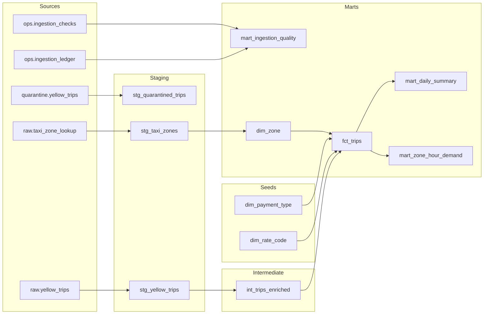

# Lineage

Generated by `scripts/lineage.py` from dbt's `manifest.json` (dbt 1.12.6, generated 2026-10-24T08:49:48.803355Z). Edit the dbt project, not this file.

| model | layer | materialization | tests | what it is |
|---|---|---|---:|---|
| `ops.ingestion_checks` | source | source | 0 | Rows failed and rows first-failed per month and reason code. |
| `ops.ingestion_ledger` | source | source | 0 | One row per loaded month with the counts and file digest of the last load. |
| `quarantine.yellow_trips` | source | source | 0 | One row per rejected trip record with its machine-readable reason codes. |
| `raw.taxi_zone_lookup` | source | source | 0 | The TLC taxi zone lookup (265 zones). |
| `raw.yellow_trips` | source | source | 0 | One row per yellow-taxi trip that passed every row rule. |
| `dim_payment_type` | seed | seed | 2 | Payment type codes from the TLC yellow-taxi data dictionary. |
| `dim_rate_code` | seed | seed | 2 | Rate code values from the TLC yellow-taxi data dictionary. |
| `stg_quarantined_trips` | staging | view | 3 | The quarantined trip records with their reason codes, for analysis of what was rejected and why. |
| `stg_taxi_zones` | staging | view | 2 | Zone lookup with the missing borough, zone and service-zone names filled in as 'Unknown'. |
| `stg_yellow_trips` | staging | view | 1 | Typed, renamed view over raw.yellow_trips. |
| `int_trips_enriched` | intermediate | view | 1 | One row per loaded trip with derived duration, average speed, tip share and time parts, plus `trip_id`, a hash of the fields the duplicate rule uses (vendor, pickup, drop-off, both zones, distance, fare, total). |
| `dim_zone` | marts | table | 2 | One row per TLC taxi zone, with flags for Manhattan and airports. |
| `fct_trips` | marts | incremental | 9 | Fact table, one row per trip that passed validation, with zone, payment and rate names attached. |
| `mart_daily_summary` | marts | incremental | 1 | One row per day with trips, revenue, average fare, card share and average speed. |
| `mart_ingestion_quality` | marts | table | 2 | Rows in, loaded and quarantined per month, split by rejecting rule. |
| `mart_zone_hour_demand` | marts | incremental | 2 | The analysis mart: trips, passengers, fares, speed, tips and revenue per pickup zone, date and hour. |

Generic tests attached to these models: 27. Singular tests in `dbt/tests/`, each spanning several models (row-count and total reconciliation against the raw layer, the row rules, the quarantine reasons): 5.
